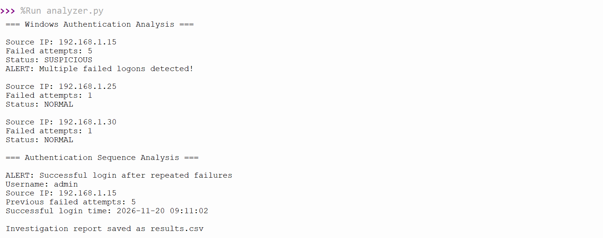
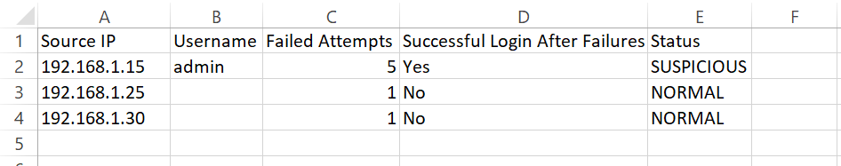

Windows Event Log Analysis

Overview

This project is a beginner-level SOC investigation and automation project focused on analyzing Windows authentication events.

The project analyzes Windows Security Event IDs **4625 (failed logon)** and **4624 (successful logon)** to identify potentially suspicious authentication activity.

The analysis focuses on detecting repeated failed logons from the same source IP followed by a successful login.

---

Project Objectives

- Analyze Windows authentication event data.
- Identify repeated failed logon attempts.
- Detect suspicious authentication sequences.
- Identify the source IP and targeted username.
- Generate an automated investigation report.
- Document findings using a SOC-style investigation process.

---

Event IDs Analyzed

| Event ID | Description |
|---|---|
| 4625 | Failed logon |
| 4624 | Successful logon |

---

Detection Logic

The Python analyzer performs the following steps:

1. Reads authentication events from `sample_events.csv`.
2. Identifies Event ID **4625** failed logons.
3. Counts failed attempts by source IP.
4. Flags IP addresses with **5 or more failed attempts** as suspicious.
5. Checks successful Event ID **4624** logons.
6. Determines whether a successful login occurred after repeated failures from the same source IP and username.
7. Generates a final investigation report in `results.csv`.

---

Investigation Findings

The analysis identified the following suspicious authentication sequence:

- **Source IP:** `192.168.1.15`
- **Target username:** `admin`
- **Failed attempts:** 5
- **Successful login after failures:** Yes
- **Successful login time:** `2026-11-20 09:11:02`
- **Assessment:** Potentially suspicious

The sequence of repeated failed logons followed by a successful login may indicate possible brute-force activity. However, this evidence alone does not prove that the activity was malicious.

Additional investigation would be required to determine whether the source IP was authorized and whether the successful login was legitimate.

---

Evidence

The investigation is based on the authentication events contained in `sample_events.csv`.

The relevant sequence was:

```text
4625 → Failed
4625 → Failed
4625 → Failed
4625 → Failed
4625 → Failed
4624 → Successful
```

All five failed attempts originated from:

```text
192.168.1.15
```

and targeted:

```text
admin
```

---

MITRE ATT&CK Mapping

The observed behavior has a potential mapping to:

T1110 — Brute Force

Repeated authentication failures may be consistent with brute-force techniques.

This mapping is considered a potential classification rather than confirmation of an attack.

---

Automated Analysis

The project uses Python to automate the investigation process.

Technologies Used

- Python
- CSV data processing
- `csv` module
- `collections.Counter`
- Windows Security Event IDs
- SOC investigation methodology
- MITRE ATT&CK

---

Project Structure

```text
windows-event-log-analysis/
├── analyzer.py
├── event-analysis.md
├── sample_events.csv
├── results.csv
└── screenshots/
    ├── detection-output.png
    └── investigation-report.png
```

File Description

| File | Purpose |
|---|---|
| `analyzer.py` | Python script used for automated authentication analysis |
| `sample_events.csv` | Sample Windows authentication event data |
| `results.csv` | Generated investigation report |
| `event-analysis.md` | Manual investigation and analyst findings |
| `detection-output.png` | Screenshot of detection output |
| `investigation-report.png` | Screenshot of the final investigation report |

---

Example Detection Output

```text
=== Windows Authentication Analysis ===

Source IP: 192.168.1.15
Failed attempts: 5
Status: SUSPICIOUS
ALERT: Multiple failed logons detected!

=== Authentication Sequence Analysis ===

ALERT: Successful login after repeated failures
Username: admin
Source IP: 192.168.1.15
Previous failed attempts: 5
Successful login time: 2026-11-20 09:11:02
```

---

Screenshots

Detection Output



Investigation Report



---

Analyst Assessment

The authentication activity from `192.168.1.15` is classified as **potentially suspicious** because five failed logon attempts against the `admin` account were followed by a successful login.

A real SOC investigation would continue by examining:

- Whether the source IP belongs to an authorized user or system.
- The affected Windows system.
- Whether the `admin` account normally logs in from this source.
- Additional Windows security events.
- Other activity occurring around the same timestamp.
- Whether similar authentication activity occurred elsewhere.

---

Disclaimer

This project uses simulated sample authentication data for educational and portfolio purposes. The detection logic is designed to demonstrate basic SOC investigation and automation concepts and should not be considered a complete production-grade detection system.
